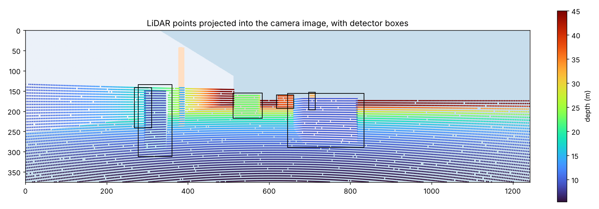
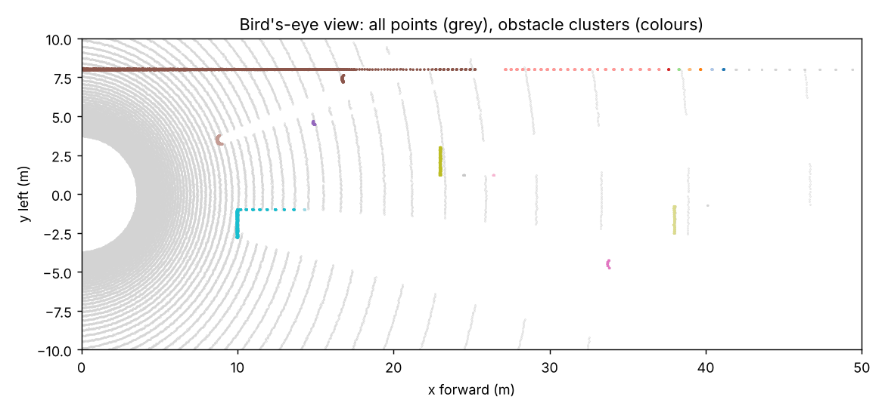
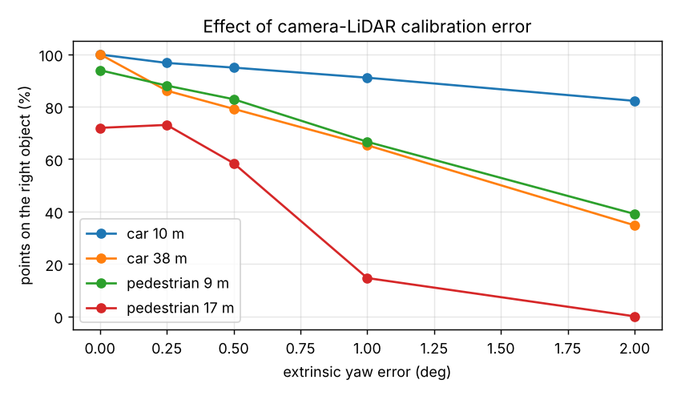

# LiDAR Point Clouds and Camera–LiDAR Fusion

A classic LiDAR perception pipeline and camera–LiDAR fusion, built from scratch with NumPy,
SciPy and scikit-learn and tested on a simulated 64-beam LiDAR and camera with known ground truth:

- **Point-cloud processing:** region-of-interest crop, voxel-grid downsampling,
  RANSAC ground-plane fitting, KD-tree Euclidean clustering and DBSCAN, object boxes.
- **Camera–LiDAR projection:** extrinsic transform, pinhole projection, KITTI calibration format.
- **Fusion:** four ways to give a 2D camera detection a distance from LiDAR, and where each fails.
- **Calibration sensitivity:** how far projected points move with an extrinsic rotation error.



## Scene

A street with three cars, three pedestrians, a pole and a wall on a road rising 2 cm per metre.
The LiDAR has 64 beams from +2° to −24.8° and 0.2° horizontal steps (similar to KITTI's
Velodyne HDL-64E), 2 cm range noise and 2 % dropouts. The camera has KITTI-like intrinsics
and sits 27 cm in front of the LiDAR.

## Results (`python -m examples.run_pipeline`)

### Ground removal

| Method | Ground recall | Precision | Obstacle points removed |
|---|---|---|---|
| Height threshold | 90.5 % | 100.0 % | 0 |
| RANSAC plane | 100.0 % | 99.6 % | 170 |

A fixed height threshold misses the far road, which rises with the slope; those points would
become false obstacles. RANSAC recovers the slope (0.020) and only loses the lowest
centimetres of real objects.



### Clustering

KD-tree Euclidean clustering finds 7 of 8 objects (DBSCAN: same result). The missing one is a
pedestrian standing 0.3 m from a wall, merged with it (under-segmentation); the far wall breaks
into pieces at grazing angles (over-segmentation). Cars seen from behind give boxes only 0.1 m
long: the LiDAR sees a partial view, so real systems fit a car-sized box instead.

### Distance for each camera detection (metres)

| Object | True | Median | Nearest group | Largest group | Best cluster |
|---|---|---|---|---|---|
| car A | 10.0 | 10.01 | 10.00 | 10.00 | 9.95 |
| car B | 23.0 | 23.00 | 23.00 | 23.00 | 22.95 |
| car C | 38.0 | 38.01 | 38.00 | 38.00 | 37.93 |
| pedestrian 1 | 8.7 | 8.82 | 8.75 | 8.75 | 8.66 |
| pedestrian 2 (behind car A) | 33.7 | **10.01** | **10.00** | **10.00** | 33.70 |
| pedestrian 3 (next to wall) | 16.7 | 16.70 | **8.73** | 16.78 | **8.66** |

No method is always right: the median and depth-group methods fail on the occluded pedestrian,
and the cluster-based method inherits the clustering error for the pedestrian merged with the
wall. In practice, combine 3D clusters with class-size checks and tracking over time.

### Calibration error

| Yaw error | Pixel shift | car 10 m | car 38 m | ped. 9 m | ped. 17 m |
|---|---|---|---|---|---|
| 0.00° | 0.0 px | 99.9 % | 100.0 % | 93.9 % | 71.9 % |
| 0.25° | 3.1 px | 96.7 % | 86.1 % | 88.0 % | 73.0 % |
| 0.50° | 6.3 px | 94.9 % | 79.2 % | 82.8 % | 58.4 % |
| 1.00° | 12.6 px | 91.1 % | 65.3 % | 66.6 % | 14.6 % |
| 2.00° | 25.2 px | 82.2 % | 34.7 % | 39.1 % | 0.0 % |

Share of each object's LiDAR points that land on the same object in the image. A rotation error
shifts all points by about f·tan(error), independent of distance, so small and far objects suffer
first: camera–LiDAR extrinsics need roughly 0.1–0.2° accuracy.



## Repository structure

```
src/
  scene.py        synthetic street, LiDAR scan simulation, camera, detector boxes
  pointcloud.py   crop, voxel grid, RANSAC plane, Euclidean clustering, boxes
  projection.py   LiDAR -> image projection
  fusion.py       distance for a 2D box (median, depth groups, best cluster)
  kitti_io.py     KITTI .bin point clouds and calibration files
examples/
  run_pipeline.py the whole pipeline; prints the tables above (--figures saves the plots)
tests/
  test_pointcloud.py   unit tests (pytest)
notebooks/
  lidar_pointcloud_fusion.ipynb   step-by-step version
extras/           the same pipeline with Open3D, PCL (C++) and a ROS 2 PointCloud2 node
                  (reference sketches, not run in this repository)
```

## Run

```bash
python3 -m venv .venv && source .venv/bin/activate
pip install -r requirements.txt
pytest                                   # unit tests
python -m examples.run_pipeline          # all results
python -m examples.run_pipeline --figures
```

## Real data

`src/kitti_io.py` reads the KITTI 3D object detection format (`velodyne/*.bin`,
`calib/*.txt`), so the same pipeline runs on real scans: load a frame, crop, remove the ground,
cluster, and project into `image_2` with `P2 · R0_rect · Tr_velo_to_cam`.
